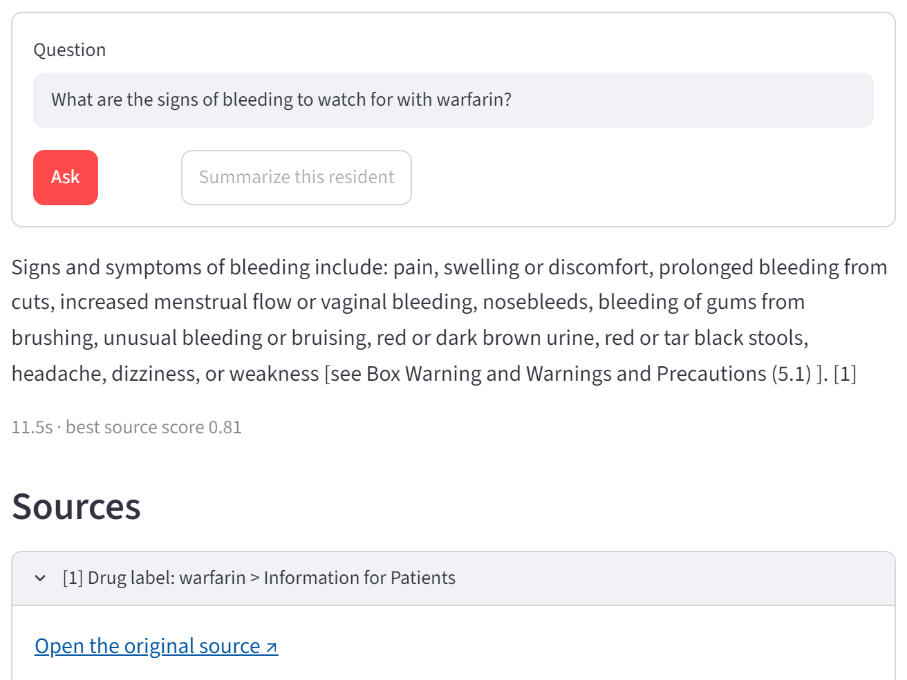
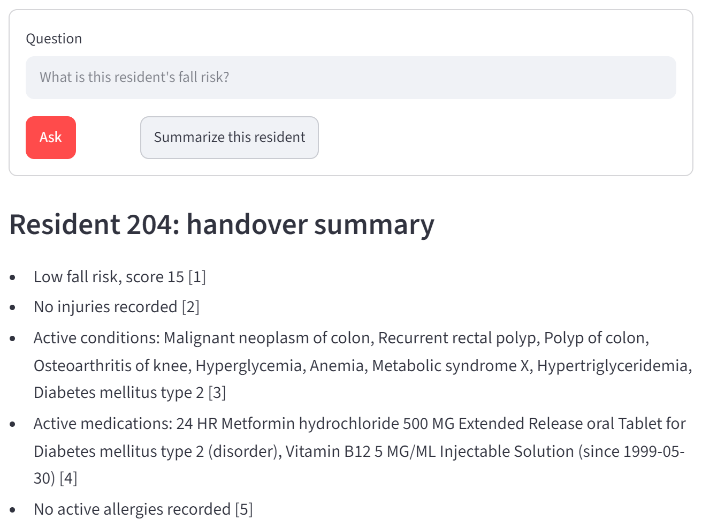
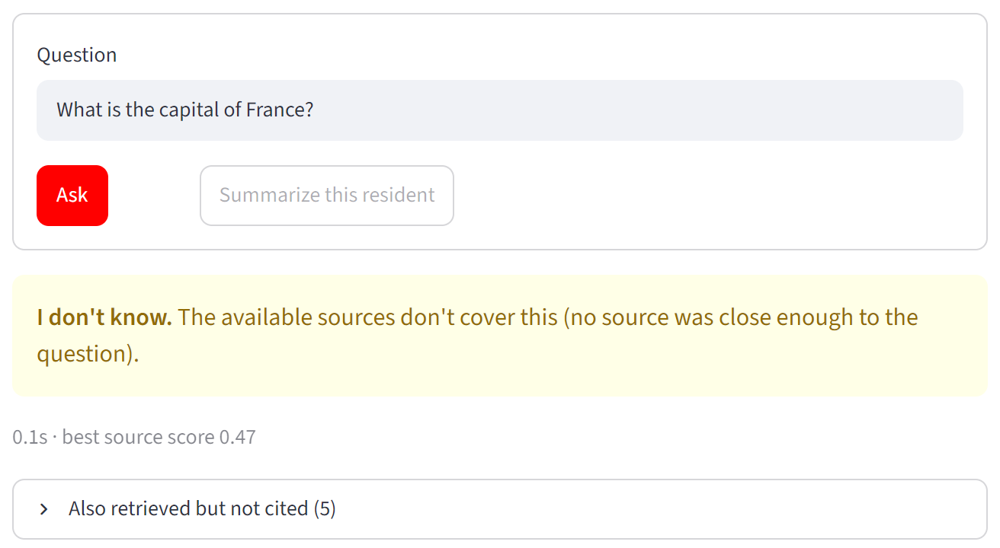

# Resident Care Q&A Assistant

Answers questions from staff in an Ontario long-term care home, using a resident's record, Ontario's
long-term care law, and clinical guidelines. Every answer cites its source, and when the sources
don't cover a question it says "I don't know" instead of guessing.

**Synthetic data only. No real patient data is used anywhere in this project.**



## What it does
- Loads 1,000 synthetic residents (Synthea) and 31 public documents into Databricks: the Fixing
  Long-Term Care Act, O. Reg. 246/22, 3 RNAO guidelines, Public Health Ontario infection-control
  guidance, and 25 drug labels.
- Cleans the data in three layers (bronze, silver, gold), checks its quality on every run, and removes
  personal identifiers before anything can be searched.
- Splits every source into short, citable chunks (for example `O. Reg. 246/22, s. 54` or
  `Resident 204 > Active medications`) and stores them in a vector database (Qdrant).
- Answers questions with a local LLM, which only sees the sources found for that question. A question
  about a resident can only see that resident's record.
- Runs as a weekly Databricks job, and is measured with a 60-question test set tracked in MLflow.

## Results
Tested on 60 questions: 25 about residents, 25 about the law and guidelines, and 10 that the
assistant must refuse (off-topic, or about something the record doesn't say).

| Version | Correctly cited answers | Resident questions | Unsupported answers | Must-refuse refused |
|---|---|---|---|---|
| First version (prompt v1) | 86% | 80% | 0% | 10/10 |
| Final version (prompt v2) | 94% / 96% (two runs) | 100% | 0% | 10/10 |

- A correct source was in the top 5 search results for all 50 answerable questions, so every miss in the
  first version came from the model, not the search. The 3B model answered yes/no questions with only a
  citation (like `[ S1 ]`), which the checks refused. One prompt rule fixed most of them.
- Of four chunk sizes (100, 200, 300, and 400 words), 200-word chunks put the right source first most
  often (MRR 0.967). Filtering by document type helped at every size.
- Turning off the citation check raised unsupported answers from 0% to 4.2%.
- The privacy check found 0 leaked identifiers in all 10,155 chunks.
- Running the same version twice gave 94% and 96%, so differences of one question (2 points) are noise.

Two more examples: a handover summary where every point cites a section of the record, and an
off-topic question refused before the model is even called.





## How to run
Requires Python 3.12, Docker, [Ollama](https://ollama.com), and a free
[Databricks Free Edition](https://www.databricks.com/learn/free-edition) workspace.

```bash
pip install -r requirements.txt
docker compose up -d
ollama pull qwen2.5:3b
python scripts/load_qdrant.py --config w200_o40
streamlit run app/streamlit_app.py
```
- `docker compose up -d` starts Qdrant on port 6333.
- `load_qdrant.py` downloads the chunks and embeddings that the Databricks job exported, and loads them
  into Qdrant.
- The last command opens the app in your browser.

To build the data yourself: `scripts/generate_residents.sh` and `scripts/download_sources.py` create the raw
files, `scripts/upload_to_volume.sh` uploads them to Databricks, and `scripts/deploy_job.sh` creates the
weekly job (copy `.env.example` to `.env` first).

To run the tests: `python -m pytest`. To rerun the evaluation: `python scripts/evaluate.py --config w200_o40 --k 5`.

## How it works
- **Pipeline:** five Databricks notebooks (PySpark, Delta tables) run as one job: bronze keeps the raw
  files as they arrived, silver cleans and types them, gold builds one record per resident, then the
  data is split into chunks and embedded (BGE-small).
- **Data quality:** every step saves its checks (row counts, missing values, duplicates, records that point
  at something that doesn't exist) to a table, and a failed check stops the job.
- **Privacy:** names, addresses, ID numbers, and exact birth dates are removed, and each resident gets a
  short ID. Every chunk is scanned for identifiers and the job fails on any leak. A planted test record is
  scanned on every run too, so the job also fails if a detector stops working.
- **Answers:** if no source is close enough to the question, the model is never called. The model
  (qwen2.5:3b, running locally so resident data never leaves the machine) must cite a source for every
  claim. Answers without a valid citation are refused, and wrong citation numbers are corrected by
  comparing each sentence with its sources.

## Limitations
- Synthetic residents only. Real de-identification would also shift event dates, which this project keeps.
- The test set is small: one question is 2 points.
- The 3B model sometimes cites a law's own paragraph number instead of a source and the answer gets
  refused, and one answer named a different screening tool than the guideline. Citation checks can't
  catch an answer that cites the right source but gets it wrong.
- Databricks Free Edition can't reach a laptop, so Qdrant is loaded from an exported file, and embedding
  runs on one machine (about 48 minutes per chunk size).
- A demo, not clinical advice or a deployed service.

## Project structure
```
app/streamlit_app.py    the app
databricks/notebooks/   bronze, silver, gold, chunks, embeddings
databricks/jobs/        the weekly job definition
src/rcqa/
    dq.py               data-quality checks
    gold.py             de-identified resident tables
    privacy.py          identifier scan and planted test record
    chunking.py         splits sources into citable chunks
    index.py            Qdrant collections and filtered search
    rag.py              answers, "I don't know" checks, citation checks
    evaluation.py       test-set scoring
scripts/                data download, Qdrant loading, evaluation, job deployment
data/eval/              the 60 test questions and every run's results
tests/                  unit tests
docs/                   demo script, interview notes, screenshots
```

## Data sources
- Synthea synthetic patients: https://github.com/synthetichealth/synthea
- Fixing Long-Term Care Act, 2021 and O. Reg. 246/22 (e-Laws): https://www.ontario.ca/laws/statute/21f39, https://www.ontario.ca/laws/regulation/220246
- RNAO best practice guidelines (falls; delirium, dementia and depression; pressure injuries): https://rnao.ca/bpg
- Public Health Ontario, IPAC for long-term care homes: https://www.publichealthontario.ca
- openFDA drug labels: https://open.fda.gov/apis/drug/label/

Every document's exact URL and retrieval date is listed in `data/sources/sources.csv`. Publishers keep
their copyright; the documents are not redistributed in this repo.
