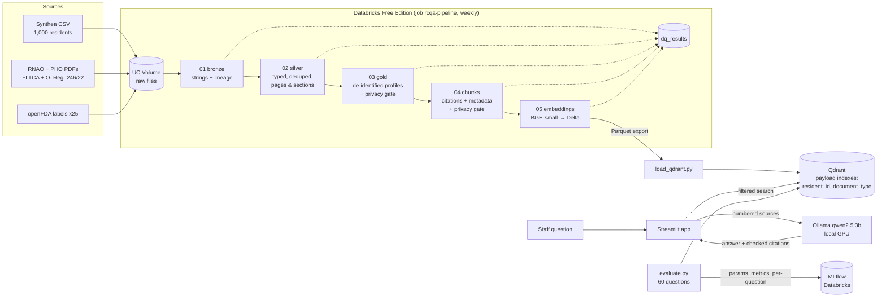

# Resident Care Q&A Assistant

> A cited question-answering assistant for long-term care staff, built on a
> **Databricks** medallion pipeline (PySpark + Delta Lake + MLflow + Jobs) and a
> **Qdrant** RAG pipeline with filtered vector search.
> **Synthetic data only. No real patient data is used anywhere in this project.**


## 1. What it does
Staff ask plain-English questions and get answers with citations to the exact
resident record or document section. If the sources don't support an answer,
it says **"I don't know."**

Example questions:
- "Has resident 204 had any falls, and what medications are they on?"
- "What does the RNAO guideline recommend after a resident falls?"
- "What does Ontario's long-term care regulation require for fall prevention?"
- "What are the main side effects listed on the label for warfarin?"

## 2. Architecture


Why this shape:
- **Delta is the source of truth.** Qdrant is a disposable index that can be rebuilt from
  `gold_chunk_embeddings` at any time.
- **Privacy is enforced twice before anything is embedded** (gold and chunks), and filtered
  search keeps one resident's question inside that resident's record.
- **Everything is free and local where it matters.** The LLM runs on the laptop, so resident
  text never leaves the machine.

## 3. Data sources
Every cited source is recorded in [`data/sources/sources.csv`](data/sources/sources.csv)
with its citation URL, SHA-256 and retrieval date. Raw files are git-ignored and
rebuilt by the scripts below. Publishers keep copyright; files are used for
non-commercial education and are not redistributed in this repo.

| Source | Type | What it is |
|---|---|---|
| [Synthea](https://github.com/synthetichealth/synthea) | residents | 1,000 living synthetic patients aged 65–95 (+773 deceased during simulated history), seed 42, CSV export |
| [RNAO: Preventing Falls and Reducing Injury from Falls, 4th ed. (2017)](https://rnao.ca/bpg/guidelines/prevention-falls-and-fall-injuries) | guideline | Fall prevention best practice |
| [RNAO: Delirium, Dementia, and Depression in Older Adults, 2nd ed. (2016)](https://rnao.ca/media/3485/download) | guideline | Assessment and care |
| [RNAO: Pressure Injury Management, 4th ed. (2024)](https://rnao.ca/bpg/guidelines/pressure-injuries) | guideline | Risk assessment, prevention, treatment |
| [PHO: IPAC for Long-Term Care Homes (2020)](https://www.publichealthontario.ca/en/Health-Topics/Infection-Prevention-Control/Long-Term-Care) | ipac_guidance | Infection prevention key principles |
| [Fixing Long-Term Care Act, 2021](https://www.ontario.ca/laws/statute/21f39) | legislation | e-Laws current consolidation |
| [O. Reg. 246/22: General](https://www.ontario.ca/laws/regulation/220246) | regulation | e-Laws current consolidation (falls program: s. 54) |
| openFDA / DailyMed drug labels ×25 | drug_label | Top 25 ongoing medications among living residents, matched by RxNorm code |

Reproduce:
```bash
bash scripts/generate_residents.sh          # needs Java 17+ and tools/synthea-with-dependencies.jar
python scripts/download_sources.py          # documents + drug labels -> sources.csv
powershell -ExecutionPolicy Bypass -File scripts/convert_elaws_docs.ps1   # e-Laws .doc -> .txt (needs Word)
```

## 4. Pipeline (Databricks)
All tables live in Unity Catalog under `workspace.rcqa`, stored as Delta.

| Layer | Notebook | Tables | What happens |
|---|---|---|---|
| Raw | `scripts/upload_to_volume.sh` | Volume `/Volumes/workspace/rcqa/raw` | 9 clinical Synthea tables (gzipped 900 MB → 58 MB), PDFs, law text, label JSON |
| Bronze | `01_bronze` | `bronze_<table>`, `bronze_documents`, `bronze_drug_labels`, `bronze_sources` | Raw as-is, every CSV column a string, plus `_source_file` and `_ingested_at` lineage |
| Silver | `02_silver` | `silver_<table>`, `silver_document_pages`, `silver_drug_label_sections` | snake_case, blanks → NULL, typed dates/numbers, exact duplicates removed; PDFs per page, labels per section |
| Gold | `03_gold` | `gold_residents`, `gold_conditions`, `gold_medications`, `gold_encounters`, `gold_allergies`, `gold_fall_risk`, `gold_resident_profiles` | Living residents only, de-identified (see Privacy); one profile row per resident with sorted arrays + rendered `profile_text` |
| Chunks | `04_chunks` | `gold_chunks` (partitioned by `config_id`) | Every source split into citable units, then into word windows; privacy-scanned before anything is embedded |
| Embeddings | `05_embeddings` | `gold_chunk_embeddings` + Parquet export in the Volume | BGE-small vectors (384-d), checked: one per chunk, right dimension, unit length |

**Data quality.** Every layer writes to `dq_results` (one row per check per run):
row counts, null counts on required fields, duplicate keys, exact duplicate rows,
and **orphan foreign keys** (e.g. a medication pointing at a patient or encounter
that doesn't exist). `error` checks stop the job; `warn` checks are recorded only.
The measuring (`profile`, Spark) and judging (`evaluate`, plain Python) halves are
split so the rules are unit-tested without a cluster.

**Chunking (`src/rcqa/chunking.py`).** Split on the document's own structure first,
then pack each unit into windows of at most `chunk_size` words with `overlap` words carried over:

| Source | Unit | Citation stored on the chunk |
|---|---|---|
| Act + regulation (e-Laws) | numbered section | `O. Reg. 246/22, s. 54 (Falls prevention and management)` |
| RNAO / PHO PDFs | page (running headers removed, section tab kept, near-empty pages dropped) | `Preventing Falls… (4th ed.), PDF p. 37 (Recommendations)` |
| Drug labels (openFDA) | label section | `Drug label: warfarin sodium > Boxed Warning` |
| Resident profiles | profile section (`## Active medications`…) | `Resident 204 > Active medications (as of 2026-11-04)` |

Each chunk carries `source_id`, `document_type`, `section`, `page`, `resident_id`
(profiles only), `source_date`, `citation`, `citation_url`, the plain `text` shown to
staff, and an `embed_text` with a context header (e.g. `O. Reg. 246/22, s. 54: Falls
prevention and management`) so a window from the middle of a section still says what
it is about. `chunk_size` / `overlap` are job parameters; each configuration is its own
`config_id` slice (`w200_o40`), written with Delta `replaceWhere`, so the evaluation can compare
configurations without overwriting each other.

| Baseline `w200_o40` (latest run) | Chunks | Sources | Avg words |
|---|---|---|---|
| Resident profiles | 6,000 | 1,000 residents | 44.0 |
| Drug labels | 1,535 | 25 | 172.4 |
| Guidelines (RNAO) | 1,001 | 3 | 161.1 |
| Regulation (O. Reg. 246/22) | 791 | 1 | 141.7 |
| IPAC guidance (PHO) | 443 | 1 | 163.4 |
| Act (FLTCA 2021) | 385 | 1 | 139.2 |
| **Total** | **10,155** | 31 + 1,000 | |

Chunk DQ (all `error`): unique `chunk_id`, required fields not null, no chunk over
`chunk_size`, every source and all 1,000 residents have chunks, `resident_id` set if and
only if the chunk is a profile, every document chunk has a URL to cite.

Bugs this caught on the first Databricks run: the Act produced **0** chunks because
Windows `CRLF` line endings became blank lines and broke heading detection (fixed in
`clean_text`, regression test added), and 17 pages that were just a page number and a
tab label were turned into useless chunks (now dropped).

**Scheduled job.** [`databricks/jobs/rcqa_pipeline.json`](databricks/jobs/rcqa_pipeline.json)
defines `rcqa-pipeline`: bronze → silver → gold → chunks → embeddings, every Sunday at 03:00
(America/Toronto). It runs from the Databricks Git folder, with one shared `run_id` per run in
`dq_results` and email on failure. `scripts/deploy_job.sh` creates or updates it idempotently
(`jobs create` / `jobs reset`). Any `error` DQ check, privacy leak or broken canary fails the run.

**CI/CD ([`.github/workflows/ci.yml`](.github/workflows/ci.yml)).** Every push and PR runs the
pytest suite on Python 3.12 + Java 17 (local PySpark). Live tests (Databricks scans, Qdrant search)
skip themselves without credentials. On `main`, if the repo has `DATABRICKS_HOST`,
`DATABRICKS_TOKEN` and `DATABRICKS_GIT_FOLDER_ID` secrets, a deploy job pulls `main` into the
Databricks Git folder and updates the job definition from the repo.

**A bug the first scheduled run caught.** `spark.read.option("wholetext", True)` was silently
ignored on serverless, so each drug-label JSON file became ~140 rows of single lines, and silver
failed parsing them. Fixed by passing `wholetext=True` as an argument and every reader option as
a string. A new bronze check, `rows_per_file` (one label file = one row), now fails the job on
its own if this happens again.

## 5. Retrieval + generation (Qdrant RAG)
**Embeddings.** `BAAI/bge-small-en-v1.5` (free, 384-d) through fastembed (ONNX, no PyTorch),
so Databricks and the app run the *same* model files. Documents are embedded from
`embed_text` (chunk + context header); queries get BGE's search instruction prefix.

**Databricks → Qdrant.** Free Edition serverless can't reach a Qdrant on a laptop, so
Delta (`gold_chunk_embeddings`) is the source of truth, and `05_embeddings` exports one
Parquet file to the Volume. `scripts/load_qdrant.py` downloads it and upserts into
whatever `QDRANT_URL` points at: local Docker now, and Qdrant Cloud the same way.

**Free Edition limitation, measured.** The first design embedded with `mapInPandas` on
workers. That failed: workers have no internet (the model can't be downloaded), and with
the model cached in the Volume, the UDF tasks died with an opaque `INTERNAL_ERROR` after
~20 min. The workaround embeds on the driver in batches:

| Where | Throughput (BGE-small, CPU) | 10,155 chunks |
|---|---|---|
| Databricks Free Edition serverless driver | ~3.5 chunks/s | 2,905 s (48 min) |
| Laptop CPU (same model, fastembed) | ~14 chunks/s (14,262 chunks in 1,047 s, sharing the CPU with an eval run) | ~12 min |

**Qdrant layout (`src/rcqa/index.py`).**
- One collection per chunking config (`chunks_w200_o40`). The app reads the alias
  `rcqa_chunks`, which is swapped atomically when a better config wins.
- Cosine distance. Point id = UUIDv5(`chunk_id`), so reloads are idempotent.
- Payload indexes: `resident_id` (integer), `document_type` and `source_id` (keyword).
  The payload carries everything needed to cite: `citation`, `citation_url`, `section`, `page`, `text`.

**Filtered search: privacy by construction.**

| Question about… | Filter |
|---|---|
| A resident (`resident_id=204`) | `resident_id = 204`, optionally OR the public types asked for (e.g. `drug_label`) |
| Rules or guidelines (no resident) | `document_type IN (public types)`, never resident profiles |

A question can therefore never retrieve another resident's chunk, even when that chunk
is the closest vector. A unit test plants exactly that case, and a live test checks it
against the real collection.

**Sanity checks on the real index** (`tests/test_search_live.py`; scored evaluation is in section 6):
"post-fall assessment" with `regulation` → top hit `O. Reg. 246/22, s. 54 (Falls
prevention and management)`; resident 204 searches return only resident 204; public
searches return no resident chunks.

**Answers (`src/rcqa/rag.py`).** LLM: `qwen2.5:3b` running locally through Ollama on the
GPU (RTX 3060, about 3–5 s per answer), at temperature 0 so evaluation runs are repeatable.
It's local, so resident chunks never leave the machine. Set `OLLAMA_MODEL` to swap models.

| Question type | What is retrieved |
|---|---|
| No resident | top-5 public chunks (optionally limited to `document_types`) |
| Resident `204` | that resident's **whole record** (~6 chunks; ranking only 6 can only drop a section) |
| Resident + references | the whole record, plus top-5 chunks of the requested public types (e.g. `drug_label`) |

**"I don't know" is enforced in code, not just requested in the prompt:**

| Guard | Refuses when | Reason code |
|---|---|---|
| Retrieval gate | best chunk scores < 0.65 (measured: on-topic ≥ 0.72, off-topic ≤ 0.61); the LLM isn't called | `low_retrieval_score` |
| Prompt | the model replies "I don't know" | `llm_idk` |
| Citation check | no valid `[S#]` citation in the answer | `no_citations` |
| Content check | the answer is only citations (e.g. `[2]`) | `no_content` |
| Error | Ollama is down or times out: refuse, never guess | `llm_error` |

**Citations are checked, not trusted.** Sources are labelled `[S1]`, `[S2]`… because laws and
labels are full of their own numbers ("7. Every resident has the right…"). The 3B model cited
the Bill of Rights' paragraph numbers until the labels changed. After generation:
- citations to sources that weren't given are dropped and counted;
- each claim's words are compared with the source it cites. If another source clearly matches
  better, the citation is corrected and counted (`recited`). In testing, the model quoted s. 54
  word for word but labelled it s. 298;
- sentences without any citation are counted (`uncited_sentences`, a stage-8 metric).

**Summarize this resident.** Every section of the record goes to a handover prompt
(`- point [S#]` bullets), with the same citation checks.

Known weaknesses of the 3B model are measured in section 6.

## 6. Evaluation and results
**Eval set** (`data/eval/questions.jsonl`, built by `scripts/build_eval_set.py`): 60 questions.
- 25 **resident** questions generated from the gold tables (fall risk, medications, conditions,
  allergies, injuries, encounters), each labelled with the resident's profile section that answers it.
- 25 **document** questions I wrote from the sources (regulation, Act, RNAO, IPAC, drug labels), each
  labelled with the source and an evidence regex that must appear in the retrieved chunk.
- 10 **must-refuse** questions (5 public off-topic, 5 about a resident's record that doesn't say).

Labels don't depend on chunking (source + section, or source + evidence text), so every chunk
size is scored against the same answer key.

**Metrics.**
- Retrieval: hit@k and MRR over the 50 answerable questions.
- Answers:
  - grounded rate: answered, and at least one citation is a gold source;
  - unsupported-answer %: answered, but no citation is a gold source;
  - keyword accuracy: the expected fact appears in the answer;
  - refusal rate on the 10 must-refuse questions.

Every run logs params, metrics and per-question results to the MLflow experiment `rcqa-retrieval-eval`
on Databricks, and is also saved to `data/eval/results.csv` and `data/eval/runs/`.

**Retrieval grid** (bge-small, k=5; filter = the question's document type):

| Config (words / overlap) | Chunks | Filter | Hit@1 | Hit@5 | MRR |
|---|---|---|---|---|---|
| w100_o20 | 14,262 | on | 0.86 | 0.96 | 0.906 |
| w100_o20 | | off | 0.82 | 0.96 | 0.881 |
| **w200_o40** | 10,155 | **on** | **0.94** | **1.00** | **0.967** |
| w200_o40 | | off | 0.90 | 1.00 | 0.947 |
| w300_o60 | 8,996 | on | 0.88 | 1.00 | 0.937 |
| w300_o60 | | off | 0.84 | 0.98 | 0.907 |
| w400_o80 | 8,486 | on | 0.88 | 1.00 | 0.934 |
| w400_o80 | | off | 0.82 | 1.00 | 0.896 |

200-word chunks rank the right source first most often, and the type filter adds 0.02 to 0.04 MRR
at every size. Resident questions are 1.00 everywhere because the whole record is retrieved. The
alias `rcqa_chunks` stays on `chunks_w200_o40`.

**Baseline vs best (answers)** (w200_o40, k=5, qwen2.5:3b, temperature 0):

| Run | Grounded | Resident | Document | Unsupported answers | Keyword acc. | Must-refuse refused | Uncited sentences / answer |
|---|---|---|---|---|---|---|---|
| baseline (prompt v1) | 0.86 | 0.80 | 0.92 | 0.0% | 0.80 | 10/10 | 0.58 |
| **best (prompt v2)** | **0.94 / 0.96** (2 runs) | **1.00** | 0.88 / 0.92 | **0.0%** | 0.86 / 0.88 | **10/10** | 0.29 |

Retrieval was already 100% at k=5, so all 7 baseline misses were generation failures: the 3B model
answered yes/no questions with only a citation (`[ S1 ]`, `[END] [S1]`), which the guards correctly
refused. v2 adds one prompt rule ("start a yes/no answer with Yes or No, then say what the source
shows") and accepts spaces inside citation labels.

**Ablations** (v2, w200_o40):

| Change | Grounded | Unsupported answers | Note |
|---|---|---|---|
| k=3 | 0.96 | 2.0% (1 of 49) | |
| k=5 (chosen) | 0.94 / 0.96 | 0.0% | |
| k=8 | 0.92 | 0.0% | more sources, more document refusals |
| k=5, **citation checker off** | 0.92 | **4.2% (2 of 48)** | the checker fixes wrong source numbers |

**Noise.** Running the same v2 config twice gave 0.94 and 0.96 grounded: even at temperature 0, local
GPU generation varies by about one question. So differences of 2 points are not real, and k=3 vs k=5
is a tie (k=5 kept for 0 unsupported answers in both runs).

**What still fails (v2):**
- The model sometimes cites the law's own paragraph number (`[54 (2)]`) instead of `[S1]`; the answer
  is then refused (`no_citations`). Example: "What does the regulation require after a resident falls?"
- Injury questions: the answer is grounded but doesn't name the expected injury (2 of 4 keyword misses).
- One depression-screening answer named PHQ-9 instead of the expected tool: grounded but wrong.
  Citation checks can't catch this; only keyword/semantic grading does.
- One PPE-order question is refused even though the source is retrieved.

## 7. Privacy
The data is synthetic, but the pipeline is built as if it weren't.

**De-identification by construction (silver → gold).** Gold columns are an allow-list
(`src/rcqa/gold.py`), so nothing reaches gold unless it is named there.

| Identifier | In gold? |
|---|---|
| Names, maiden name | removed |
| SSN, driver's licence, passport | removed |
| Street address, city, county, ZIP, lat/lon, birthplace | removed |
| Synthea patient / encounter / provider / payer UUIDs | removed; patient → short `resident_id` (101–1100) |
| Exact birth date | removed → age in years, **capped at 90**, plus 5-year age band |
| Deceased patients | excluded (gold = current residents) |
| Clinical event dates | **kept** (staff need "when") — see limitation below |

The UUID ↔ `resident_id` map lives only in the restricted `silver_resident_key_map`.
Ids are assigned in salted-hash order, so the number reveals nothing about the person.

**Privacy gate (blocks the job).** `03_gold` scans every row of every gold table
(~298k rows, serialised to JSON) plus every rendered profile, using two independent nets:
format patterns (SSN, UUID, licence, passport, phone, Synthea-style names) and known
values from silver (every name, ID and address, plus each resident's *own* birth date).
A **canary** sends 20 rows of real identifiers through the same serialise-and-scan path
each run, and **every detector kind** (known value, Synthea name, SSN, address, own birth
date) must fire. Just "found some leaks" isn't enough, because one broken detector
could hide behind the others.

**Every chunk is scanned again** in `04_chunks` before embedding, with its own canary
pushed through `chunk_profile()`. Resident chunks use every detector. Public-document
chunks (laws, guidelines, labels) count only known patient values (names, IDs,
addresses); format patterns there are noise. The first run flagged 13 "leaks", and all
were footnote markers glued to words (`Learning45`), journal IDs and DOI UUIDs.

| Check (latest run) | Result |
|---|---|
| Leaks in 7 gold tables + 1,000 profile texts | **0** |
| Leaks in 10,155 chunks (baseline) and 41,899 chunks (all 4 configs, live test) | **0** |
| Detector kinds the canaries missed (gold, chunks) | 0, 0 |

`pytest` re-runs the scan from a laptop against live gold profiles and every chunk (`tests/test_privacy_live.py`,
skipped in CI where there are no credentials) and unit-tests every identifier type.

**Known limitation.** Real-world Safe Harbor de-identification would also generalise or
shift event dates (e.g. a random per-resident offset). That was left out so staff answers
keep real dates, which is acceptable only because the data is synthetic.

## 8. How to run it
**Databricks (once).** Create a Free Edition workspace, the `workspace.rcqa` schema and the
`raw` Volume (`scripts/check_setup.py` checks all three), upload `data/raw` with
`scripts/upload_to_volume.sh`, then add this repo as a Git folder and deploy the job:

```bash
DATABRICKS_PROFILE=rcqa bash scripts/deploy_job.sh    # creates or resets the rcqa-pipeline job
databricks jobs run-now <job_id> -p rcqa               # bronze -> silver -> gold -> chunks -> embeddings
```

**Locally.**
```bash
docker compose up -d            # Qdrant on http://localhost:6333
python -m venv .venv && .venv\Scripts\activate
pip install -r requirements.txt
ollama pull qwen2.5:3b          # run it from the Ollama app so it uses the GPU (`ollama ps`)
python scripts/load_qdrant.py --config w200_o40      # export from 05_embeddings -> Qdrant
streamlit run app/streamlit_app.py                   # http://localhost:8501
```

**CLI, evaluation, tests.**
```bash
python scripts/search.py "post-fall assessment" --types regulation
python scripts/ask.py "what does the regulation say about post-fall assessment?" --types regulation
python scripts/ask.py --summarize 204
python scripts/build_eval_set.py                     # rebuilds data/eval/questions.jsonl
python scripts/build_tuning_collection.py --config w300_o60   # another chunk config -> Qdrant
python scripts/evaluate.py --config w200_o40 --k 5             # logs to MLflow + data/eval/results.csv
python scripts/evaluate.py --config w300_o60 --k 3 --retrieval-only
pytest
```

**CI** (`.github/workflows/ci.yml`): every push runs pytest on Python 3.12 with Java 17
(live tests skip themselves without Qdrant/Databricks). On `main`, if the repo secrets
`DATABRICKS_HOST`, `DATABRICKS_TOKEN` and `DATABRICKS_GIT_FOLDER_ID` are set, it pulls the
Databricks Git folder to the new commit and redeploys the job definition.

## 9. Repo layout
```
databricks/notebooks/   PySpark notebooks: 01_bronze, 02_silver, 03_gold, 04_chunks, 05_embeddings
databricks/jobs/        rcqa_pipeline.json: the scheduled 5-task job
src/rcqa/               Shared Python: DQ, de-identification, privacy scan, chunking, embedding,
                        Qdrant index, RAG answers, evaluation metrics
app/                    Streamlit app
scripts/                Setup checks, upload, Qdrant loading, ask/search CLIs, eval set + runner, job deploy
data/raw/               Downloaded raw data (git-ignored)
data/sources/           sources.csv: every source URL used for citations
data/eval/              questions.jsonl (60 questions), results.csv, runs/*.json (per-question results)
tests/                  pytest suite (unit + live tests that skip without services)
docs/                   Demo script, interview prep
.github/workflows/      CI
```

## 10. Limitations
- **Synthetic data only.** Synthea residents, not real ones; the de-identification and privacy
  gate are tested on synthetic identifiers, so they show the design, not a certified process.
  Event dates are kept (see section 7).
- **Not clinical advice.** Answers quote public law and guidance; a 3B local model can still
  misread a source. Every answer shows its sources so staff can check them.
- **Small eval set.** 60 questions written by me from the sources (25 resident, 25 document,
  10 must-refuse). Good enough to compare configurations; too small for fine differences
  (one question = 2–4 points).
- **Free Edition limits.** Serverless workers have no internet and embedding on workers failed,
  so embeddings run on the driver (~48 min per config). Serverless can't reach a laptop, so
  Qdrant is loaded from an exported Parquet file instead of from the job.
- **One machine.** Qdrant and Ollama run locally; the app is a demo, not a deployed service,
  and has no login or access control beyond the per-resident filter.
- **Lexical citation check.** The claim-vs-source check uses word overlap, so it can miss
  paraphrases and negations.
